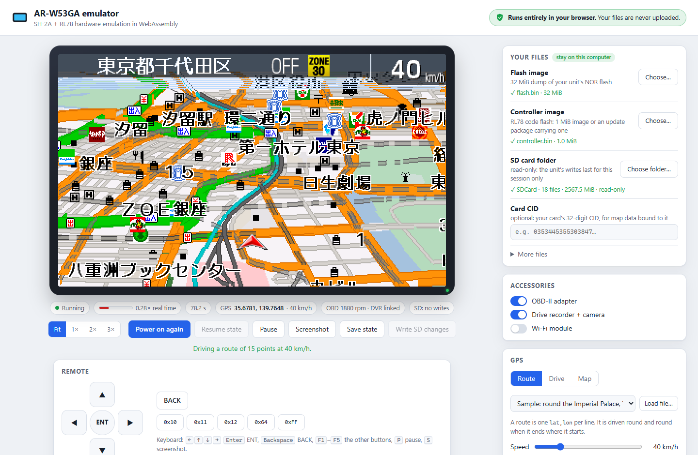
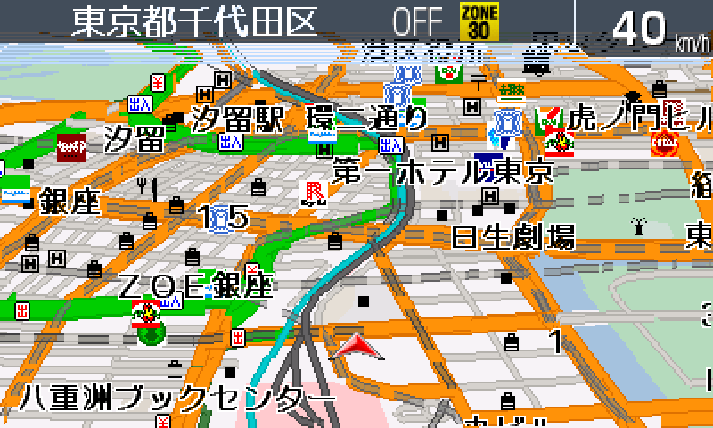
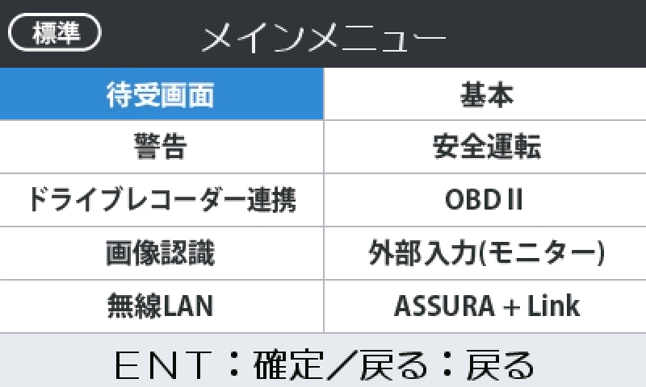
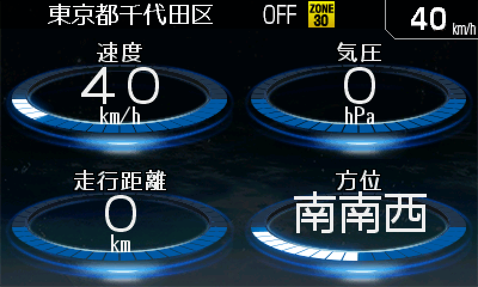
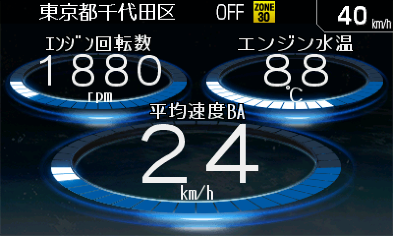
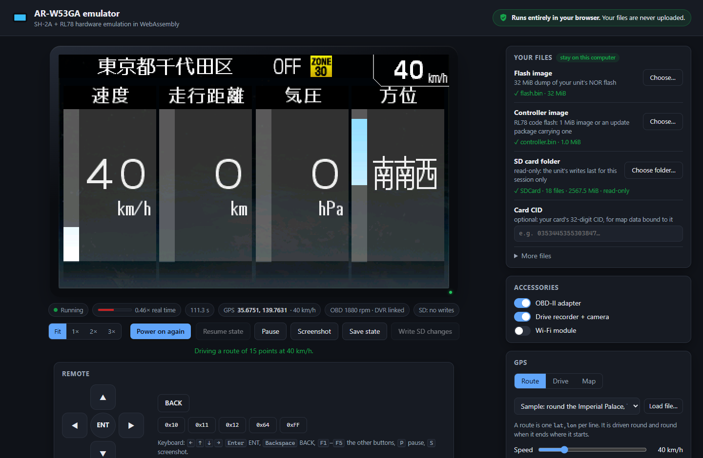

# AR-W53GA emulator

A full-system hardware emulator for the **AR-W53GA**, a Japanese in-car GPS unit with a radar/camera-warning receiver,
a 400 × 240 colour screen, an IR remote and optional OBD-II, drive-recorder and Wi-Fi accessories. It emulates the
board: a Renesas **SH7269** (SH-2A with FPU) main processor and its on-chip peripherals, the **RL78/G13** companion
controller with its own peripherals, flash memories, the SD card, the GNSS receiver, the Wi-Fi module and the
accessories. Written in Rust; runs natively in a window, headless for scripting, or **entirely inside your web browser**
through WebAssembly.

<p align="center">
  
</p>

> **This project contains no CellStar code, firmware or data.** It emulates the hardware only. To run anything you
> must supply a dump of **your own unit's** flash memory and controller, and a copy of **your own SD card**. Nothing of
> the kind is included in this repository, and please do not share yours: the software on them belongs to its owners.

---

## Contents

- [What you need](#what-you-need)
- [Quick start: in the browser](#quick-start-in-the-browser)
- [Quick start: native](#quick-start-native)
- [What is emulated](#what-is-emulated)
- [Status](#status)
- [Architecture](#architecture)
- [HLE profiles](#hle-profiles)
- [Power-on state](#power-on-state)
- [Accuracy and limitations](#accuracy-and-limitations)
- [Building and testing](#building-and-testing)
- [Screenshots](#screenshots)
- [Legal](#legal) · [Licence](#licence) · [Contributing](CONTRIBUTING.md)

## What you need

All of these come from your own unit; the emulator only reads them (it never modifies your copies unless you ask it to
write SD card changes back).

| File | What it is |
|---|---|
| **Flash image** | A complete read of the main board's 32 MiB parallel NOR flash (exactly 33,554,432 bytes). It holds the boot loader, the main program, its graphics and the unit's settings. |
| **Controller image** | The RL78/G13 controller's code flash: a 1 MiB image of both 512 KiB banks, or an update package that carries one behind an 88-byte header. |
| **SD card folder** | A copy of the files on the unit's microSD card (map, sound and data files). The emulator builds a virtual FAT32 SDHC card from the folder on the fly; nothing is copied. |
| **Card CID** | The 16-byte card identification register of your card, as 32 hex digits. The unit's map database is bound to the card it was written to: without that card's CID the unit runs but its map stays blank (Linux shows it in `/sys/block/mmcblk0/device/cid` for a card in a built-in reader; most USB readers do not expose it). |
| **HLE profile** *(optional, see below)* | A small JSON file naming a few entry points in your main program. Without one, the emulator finds them itself while the program runs. |

How you read these from your own hardware is up to you and outside the scope of this project; use only what you are
entitled to. The flash image and controller image are personal to your unit and **must never be committed or shared**.
The `.gitignore` blocks the usual file types, but take care.

## Quick start: in the browser

Everything runs locally in the page: the emulator is WebAssembly in a Web Worker, your files are read by the browser
from your disk, and **nothing is uploaded anywhere**. The page is static, so any static file server works, including
GitHub Pages.

```sh
rustup target add wasm32-unknown-unknown       # once
sh scripts/build-web.sh                        # or scripts\build-web.bat on Windows; writes web/www/w53ga_web.wasm
cargo run --release --bin w53ga-serve          # serves web/www on http://127.0.0.1:8053/ (local only)
#   or: python3 -m http.server -d web/www 8053  and open http://127.0.0.1:8053/
```

Then, in the page:

1. **Flash image**: choose it or simply drag and drop it onto the page (files are recognised by size).
2. **Controller image**: choose it (an update package on the chosen SD card is picked up automatically).
3. **SD card folder**: *Choose folder…*. In Chromium-based browsers (Chrome, Edge, Brave, Opera) this uses the File
   System Access API and the folder is **read/write**: what the unit writes to its card can be written back with
   *Write SD changes*. Other browsers fall back to a read-only folder picker; writes then last for the session only.
   A folder can also be dropped onto the page.
4. Optionally the card CID, and under *More files* an HLE profile, a power-on state or a saved state.
5. **Power on**. The unit boots from reset (about 45 s of emulated time to the map) or *Resume state* continues a
   saved one.

While it runs: the screen is shown at the largest whole-number scale that fits (or 1×/2×/3×), crisp and unfiltered; the
status bar shows the emulated time, the speed relative to real time, the GPS fix and the accessories. The on-screen
remote and the keyboard (arrows, <kbd>Enter</kbd> = ENT, <kbd>Backspace</kbd> = BACK, <kbd>F1</kbd>–<kbd>F5</kbd> =
the other buttons, <kbd>P</kbd> pause, <kbd>S</kbd> screenshot) control the unit. **GPS**: play back a route (a sample
route round the Imperial Palace in Tokyo is included; any text file with one `lat,lon` per line works), steer
manually with a heading and speed, or open an OpenStreetMap view to click where to drive (only that view fetches map
tiles from openstreetmap.org, and only when you open it). **Screenshot** saves a PNG; **Save state** downloads the whole
machine (it contains your flash image and RAM, so keep it private).

The emulated Wi-Fi module needs `w53ga-serve`: browsers cannot open raw sockets, so the page hands the module's
connections to the local server, which makes them with this computer's network. On a purely static host the module
simply finds no network.

To publish the page on GitHub Pages, run the *Pages* workflow by hand (Actions → Pages → Run workflow) after enabling
Pages with "GitHub Actions" as the source.

## Quick start: native

```sh
cargo build --release
target/release/w53ga --flash FLASH.bin --rl78 CONTROLLER.bin --sd path/to/SDCard \
                     --gps @web/www/routes/tokyo-palace-loop.txt --gps-speed 40 --obd2 --dvr
```

| Binary | Purpose |
|---|---|
| `w53ga` | Window with the unit's screen at real-time speed, keyboard as the remote, audio out. Keys as in the browser, plus <kbd>+</kbd>/<kbd>-</kbd> GPS speed, <kbd>G</kbd> GPS stop/go, <kbd>F9</kbd> save state, <kbd>Esc</kbd> quit. |
| `w53ga-headless` | Runs for a set emulated time without a window; writes screenshots (`--frame`, `--every`), saved states, audio (`--wav`), memory dumps. Also writes HLE profiles (`--make-profile`). |
| `w53ga-serve` | Tiny local web server for the browser version (127.0.0.1 only), with the Wi-Fi relay. |
| `rl78-run` | The RL78 controller on its own: disassembler, traces, SFR access report (a development tool). |

Common options (all front ends; `--help` lists them):

```
--flash FILE            32 MiB NOR flash image of the unit (required)
--rl78 FILE             controller code flash: 1 MiB image or an update package carrying one (to switch on)
--state FILE            resume a saved state instead of switching on (the flash image is still read)
--sd DIR                SD card folder (served as a FAT32 SDHC card; changes written back on exit)
--sd-readonly           keep the software's SD card writes in this session only; the folder is never changed
--sd-add CARD=HOST      add a host file to the card at CARD, never written back
--sd-cid HEX            the card's CID (32 hex digits)
--rl78-spi FILE         the controller's serial flash contents (default: an empty, provisioned chip)
--power-on-state FILE   SH7269 power-on reset state (when the build has none built in)
--hle FILE|none         HLE profile (default: a built-in profile whose checks match the flash image, else
                        entry points detected at run time; none: no HLE)
--obd2 / --dvr          plug in the OBD-II adapter / the drive recorder and its camera
--wifi [SSID[:PASS]]    fit the Wi-Fi module with one virtual access point bridged to this computer's network
--gps ROUTE             drive the GNSS receiver along "lat,lon;lat,lon;..." or @FILE; --gps-speed KMH
```

Without `--sd-readonly`, what the unit wrote to its card is copied back into the SD folder when the emulator exits
(new and changed files, new folders, deletions; nothing is written if the card's file system does not read back
cleanly or if more than 20 files would be deleted). Work on a copy of your card's files.

## What is emulated

### Main board

| Block | Model |
|---|---|
| **CPU** | Renesas SH7269 core: SH-2A with FPU (single and double precision, FPSCR rounding and denormal modes), SH-2A extensions (MOVI20/MOVI20S, MOVU, MOVML/MOVMU, MULR, DIVU/DIVS, CLIPU, bit operations, …), register banks with RESBANK/LDBANK/STBANK, exceptions and interrupt entry. About 6 instructions per peripheral clock approximates the 266 MHz core. |
| **Interrupt controller** | Priority levels from the IPR registers, vector selection, register-bank saving, IBNR. |
| **Memory** | 32 MiB CS0 NOR flash, RAM window at 0x1C00_0000, on-chip high-speed RAM, uncached mirrors (see the map below). |
| **NOR flash** | x16 parallel NOR command interface: unlock cycles, word and write-buffer programming, sector erase, reset, PPB/DYB protection command sets. Software updates that reprogram the flash work, and the result can be saved (`--save-flash`). |
| **VDC4 display controller** | Four graphics layers with all formats (RGB565/888, ARGB1555/4444/8888, CLUT8/4/1, YCbCr422), colour tables, chroma-key, alpha blending and rectangle fades, frame-buffer switching, shadow/active register latching on Vsync, panel timing and the VDC interrupts. The 400 × 240 panel is scanned in portrait and shown in landscape. |
| **Video input** | Video decoder sync (free-running without a camera, NTSC field rate with one), scaler-0 write-back of the camera picture into memory, the video plane. |
| **2D graphics** | The vector graphics processor runs undocumented microcode and is not emulated; its start-up handshake is. Drawing through the Renesas RGAH 2D API is rendered in software at the API's entry points, which are [detected at run time or named by a profile](#hle-profiles). |
| **JCU** | JPEG codec unit, decompression path: commands, interrupts, count mode and line-chunked output. |
| **SDHI 0** | SD host interface with an SDHC card: initialisation, CMD17/18/24/25, DMA, interrupts; the card is a FAT32 volume synthesised from a folder, with writes kept in an overlay and optionally written back. |
| **SDHI 1** | Second SD host, SDIO: CMD5/3/7/52/53 for the Wi-Fi module. |
| **SCIF** | FIFO serial channels 1 (drive recorder), 6 (OBD-II) and 7 (controller link): bit timing from SCBRR, FIFOs, triggers, flags, DMA requests. |
| **DMAC** | 16 channels, cycle-steal transfers, request selection (DMARS), half/full-count interrupts. |
| **Timers** | CMT0/1; MTU2 channel 1 (IR remote capture) and channels 3/4; watchdog timer with chip reset. |
| **RIIC** | IIC1 (audio codec register file) and IIC2 with an MPU-6500-compatible 6-axis inertial sensor. |
| **Audio** | SRC0 sampling-rate converter and SSI0 serial sound interface, to the host's audio device. |
| **Other** | RTC (BCD calendar from EXTAL), A/D converter (supply voltage), RSPI register files, PWM registers, standby/clock registers, and a generic latch model with reset values and access rules for registers without behaviour. |

### Companion controller and devices

| Block | Model |
|---|---|
| **RL78/G13** | R5F100LLA: RL78-S3 core with instruction timing, register banks, interrupts and priorities; clock generator, timer array unit, serial array unit (UART and CSI), A/D converter (internal temperature sensor and reference), multiplier/divider, ports, data flash, self-programming through the Renesas boot-ROM flash library (emulated at its command level), watchdog reset. |
| **Serial NOR flash** | 4 MiB SPI flash on the controller's CSI20 (read, page program, sector/block/chip erase, status, ID). |
| **Controller link** | The real controller program talks to the main program over SCIF7 ⇄ UART1, as on the board. |
| **GNSS receiver** | An NMEA receiver on the controller's UART0 (RMC/GGA/GNS/GSV with GPS and GLONASS satellites), driving along a route at a set speed, answering configuration commands. |
| **IR remote** | NEC-format remote (customer code 0x84E4) as demodulated edges into MTU1 input capture. |
| **Wi-Fi module** | SDIO 802.11 module (SDIO manufacturer 0x032C), emulated at its host interface: CIS, function registers, firmware download (the module's own firmware, which the unit's flash supplies, is checksummed but not executed), configuration protocol, scan/join with WEP/WPA keys, and data frames to a user-mode network (DHCP, DNS, TCP/UDP through host sockets, like QEMU's user networking). |
| **OBD-II adapter** | The accessory's serial protocol: presence, configuration, diagnosis and a live stream of speed, engine speed, temperatures, load, boost and battery voltage (from a simple gearbox model following the GPS speed, or set by hand). |
| **Drive recorder** | The accessory's control link (status polling, version, keys) and a synthetic NTSC camera picture of a road. |

### Memory map

| Address | Size | Contents |
|---|---|---|
| `0x0000_0000` | 32 MiB | CS0 NOR flash (`0x2000_0000`: uncached mirror) |
| `0x1C00_0000` | 2.5 MiB modelled | RAM (`0x3C00_0000`: uncached mirror) |
| `0xE800_0000`… | | Peripherals: SCIF, RSPI, A/D, JCU (`0xE801_7000`), SDHI0/1 (`0xE803_E000`/`E800`), graphics core (`0xE810_0000`) |
| `0xF000_0000` | | Cache/address-array space (accepted) |
| `0xFFF8_0000` | 64 KiB | On-chip high-speed RAM |
| `0xFFFE_0000`… | | Watchdog, INTC, DMAC, MTU2, CMT, RTC, RIIC, SRC, SSI, VDC4 and video decoder registers |

The controller has its own address space (code flash `0x00000`–`0x7FFFF`, data flash `0xF1000`, RAM `0xF7F00`–`0xFFEDF`,
SFRs at `0xFFF00`).

## Status

Measured with the unit's own software on the development machine.

| Area | State |
|---|---|
| Boot | Power-on reset → boot loader → startup screens → map in about 45 s of emulated time, with the real controller program; no scripted messages or forced state. |
| Speed | Depends on what the unit is doing. Natively: about 1.2× real time while booting, about 0.5× while driving through the dense map of central Tokyo (the unit's map drawing is CPU-heavy). The browser runs at roughly half the native speed. Both front ends pace to real time when they can. |
| Display | All layer formats, blending, fades, the video plane; the unit's map, menus, standby screens and camera screens render. 2D drawing through [HLE](#hle-profiles). |
| Controller | The real controller program runs: link handshake, mode changes, settings, GPS handling, warning database in its serial flash. |
| GPS | The map follows the emulated receiver; routes, manual driving, map clicks. |
| SD card | Read/write FAT32 card from a folder (native: write-back on exit; browser: write-back on request with a read/write folder). |
| Audio | Key sounds and voice prompts through SRC/SSI to the host. |
| OBD-II, drive recorder | Recognised by the unit; engine data and camera picture shown on its screens. |
| Wi-Fi | Module detected, scan, join (open/WEP/WPA), DHCP, DNS and TCP to the internet through the host (native, or the browser with `w53ga-serve`). |
| Software update path | The unit's own updater can reprogram the emulated NOR flash and restart through the watchdog; the result can be saved. Controller self-updates are only partly emulated (the boot-ROM commit step is not complete). |
| Saved states | Whole-machine save/restore (gzip + bincode). States are tied to the emulator version. |
| Not emulated | The graphics processor's microcode, electrical timing of SD/flash, power loss, battery/ignition sensing beyond fixed values, the inertial sensor's motion (stationary), real camera input. |

## Architecture

```
            ┌──────────────── native ────────────────┐   ┌──────────────── browser ──────────────────┐
            │ w53ga (minifb window, cpal audio)      │   │ index.html + app.js  (UI, files, keys)    │
            │ w53ga-headless (scripts, screenshots)  │   │   ⇅ postMessage                           │
            │ session.rs (files → Machine)           │   │ worker.js (pacing, SD reads, write-back)  │
            └───────────────────┬────────────────────┘   │   ⇅ C ABI          web/src/lib.rs (wasm)  │
                                │                        └──────────────────────┬────────────────────┘
                                ▼                                               ▼
   ┌──────────────────────────────── w53ga-emu (library crate, no I/O assumptions) ───────────────────────────┐
   │ machine.rs   step loop: interrupts → one SH-2A instruction → peripheral ticks; screen composition        │
   │ cpu.rs       SH-2A + FPU core            mem.rs  flash/RAM regions       hle.rs + gfx.rs  RGAH rendering   │
   │ periph/      Board: VDC4, JCU, SDHI, SCIF, DMAC, CMT/MTU2, RIIC, SRC/SSI, RTC, WDT, NOR, latches, INTC   │
   │ rl78/        RL78-S3 core, G13 peripherals, SPI flash, controller link (companion.rs)                   │
   │ gnss.rs  obd2.rs  dvr.rs  camera.rs  wlan.rs + usernet.rs  fat32.rs + sdsync.rs  checkpoint.rs           │
   └──────────────────────────────────────────────────────────────────────────────────────────────────────────┘
```

- **Time base.** Everything is clocked from the SH7269's peripheral clock P0 (33.3 MHz). The CPU executes a set number
  of instructions per P0 tick; peripherals advance in batches of P0 ticks; the RL78 runs at its 20 MHz in proportion
  and exchanges bytes with SCIF7 as they are transmitted.
- **Determinism.** A run depends only on its inputs (files, options, key presses at given emulated times), so
  headless runs are reproducible; the native and browser front ends pace emulated time to the wall clock.
- **Front-end independence.** The library has no window, audio or file-system dependency in its core; SD card reads
  go through a pluggable reader so the browser can serve them from `File` objects.
- **Saved states** serialise both CPUs, every peripheral model and all memories.

## HLE profiles

The SH7269's 2D vector graphics processor executes undocumented microcode, so the emulator does not model it. Programs
draw through Renesas' RGAH API (`fillRect`, `drawImage`, `bitBlt`, `bitBltFixedColor`, `finish`), and the emulator can
perform those calls in software instead, when it knows where they are in the loaded program. It can also skip the CPU
through an RTOS idle loop while nothing is pending, which speeds it up considerably. Both need addresses that belong to a
particular program. The emulator finds them **at run time** by default; an **HLE profile** can also name them.

### Runtime detection

With no profile, the emulator watches the program (`src/detect.rs`); it contains nothing about any particular program,
no addresses, code bytes or hashes, and finds the entry points wherever the program keeps them:

- **Drawing calls.** The CPU keeps a shadow call stack while detecting. When a call's arguments read as one of the RGAH
  drawing calls (bitmap descriptors with a valid format, clip area and pixels, points, rectangles, matrices, effect
  records), that call is explored ahead: the CPU runs on alone, time and devices held, until the program touches the
  graphics core's registers. The innermost frame whose arguments match exactly one drawing call is that call's entry
  point, and the frames down to the hardware delimit the library's code. The exploration goes on until `finish` shows
  itself (the outermost library call, from outside the library, with no drawing arguments, whose first access writes the
  register the drawing call wrote first). Then the CPU and RAM are put back as they were and the program continues with
  the hooks in place, so even the first call is drawn and the run is the same as with a profile. Later drawing calls
  into the library are recognised on entry, before any of their code runs.
- **Idle loop.** A loop taken many times over (same branch, same stack) is checked instruction by instruction: with
  interrupts enabled, no interrupt and no device access, consecutive iterations must pass through identical CPU states,
  so the loop can only be left by an interrupt and skipping it changes nothing. Three such idle periods are required.
- **Safeguards.** Ambiguous matches identify nothing (and say so); a new hook is checked on its first calls and withdrawn
  if one does not match its call's layout; a call that is never made is never hooked (it needs no hook).

Detection reports what it finds (`[hle]` lines; `w53ga-headless` prints a summary) and is kept in saved states. Once the
library, `finish` and the idle loop are known, it costs next to nothing. `W53GA_DETECT_DEBUG=1` describes what it sees.

### Profiles

A profile names the entry points instead; it takes precedence over detection (order: `--hle FILE` or the page's profile
picker, else a built-in profile whose checks match, else detection; `--hle none` turns HLE off):

```json
{ "name": "my-unit",
  "idle_loop": { "addr": "0x...", "check": "<sha256 of 32 bytes at addr>" },
  "rgah": { "fill_rect": { "addr": "0x...", "check": "..." }, "draw_image": { ... }, "bit_blt": { ... },
            "bit_blt_fixed_color": { ... }, "finish": { ... } } }
```

Each `check` is the SHA-256 of 32 bytes of the flash image at that address, so a profile is applied only to the image it
was made for and contains no code. `w53ga-headless --flash FLASH.bin --make-profile out.json --name NAME --idle ADDR
--rgah A,B,C,D,E` writes one from addresses you know. Use it with `--hle out.json` or the page's profile picker; profiles
placed in `profiles/` before building are built in and chosen automatically when their checks match.

**With HLE off** (`--hle none`) the unit still runs, but nothing drawn through the RGAH API appears and it runs more
slowly. This repository ships no profile.

## Power-on state

Switching the unit on starts from the SH7269's power-on reset state: every on-chip register at its documented reset
value (each entry cites the page of the Renesas hardware manual it comes from) and the peripheral models in their
initial state. It is built in (`data/power-on.json.gz`, embedded at build time) and contains no memory contents and no
program counter or stack pointer: the emulator reads those from the flash image's reset vectors, as the chip does.
`--power-on-state FILE` (or *More files → Power-on state* in the page) can still replace it for experiments.

## Accuracy and limitations

- The CPU cores are instruction-accurate, not cycle-accurate. The SH-2A runs about 6 instructions per peripheral clock
  (`--cpu-ratio` is fixed in the front ends); the RL78 counts its instruction cycles.
- Peripheral models implement what software has been observed to use. An unsupported configuration (for example an
  MTU2 mode that is not modelled) stops the run with a message instead of guessing; unmodelled registers are accepted,
  remembered and logged once.
- SD card and NOR flash operations complete instantly; there is no electrical timing, wear or failure.
- The SCIF transmit-FIFO-empty flag also clears when the CPU fills the FIFO above the trigger level, which avoids an
  interrupt storm with software that never acknowledges it; data and timing are unchanged.
- The JPEG decoder is functional (a standard baseline decoder), not bit-exact with the JCU's arithmetic.
- Runtime HLE detection relies on the RGAH argument layouts and on the drawing library reaching the graphics core's
  registers. It finds only the calls a program makes. If exploring the first drawing call ahead is cut short (another
  device touched first), that call is identified at its real hardware access instead and completed by unwinding it,
  which shifts timing by a few hundred instructions.
- The camera picture is synthetic; the inertial sensor reports a stationary, level unit; the supply voltage is fixed.
- Saved states are tied to the emulator version and contain your flash image and RAM: keep them private.

## Building and testing

Requirements: a recent stable Rust (1.82 or later). On Linux the window and audio front end needs the ALSA, X11 and
Wayland development packages (`libasound2-dev libx11-dev libxkbcommon-dev libwayland-dev libxcursor-dev libxrandr-dev
libxi-dev` on Debian/Ubuntu).

```sh
cargo build --release                 # native binaries in target/release
cargo test                            # CPU cores, codecs, SD card synthesis and write-back, profiles, HLE detection; no unit files needed
rustup target add wasm32-unknown-unknown
sh scripts/build-web.sh               # browser build (scripts\build-web.bat on Windows; scripts/run-web.* also serve it)
```

The repository is a Cargo workspace: the emulator library and native binaries at the root, and the WebAssembly front
end in `web/` (built only for `wasm32-unknown-unknown`). `.github/workflows/ci.yml` builds and tests on Linux, Windows
and macOS and builds the WebAssembly front end.

## Screenshots

Taken with the browser front end, running the software of the author's own unit (original firmware, Japanese
interface). They show what that software displays and are included only to illustrate the emulator.

| | |
|---|---|
|  |  |
|  |  |

<p align="center"></p>

## Legal

This is an independent, non-commercial open-source project for interoperability, preservation and research. It is
**not affiliated with, authorised, sponsored or endorsed by CELLSTAR Industries, Ltd.** or any other company.
"CELLSTAR", "ASSURA", "AR-W53GA" and other product names are trademarks or registered trademarks of their respective
owners and are used here only to describe the hardware this emulator is compatible with. "Renesas", "SuperH", "RL78"
and related names are trademarks of Renesas Electronics Corporation.

The repository contains no software, firmware, data, graphics, fonts, sounds or map data from the unit or its makers.
You are responsible for having the right to use the files you load into the emulator.

## Licence

Licensed under either of

- Apache License, Version 2.0 ([LICENSE-APACHE](LICENSE-APACHE)), or
- MIT licence ([LICENSE-MIT](LICENSE-MIT))

at your option. Unless you explicitly state otherwise, any contribution intentionally submitted for inclusion in the
work by you, as defined in the Apache-2.0 licence, shall be dual licensed as above, without any additional terms or
conditions.
